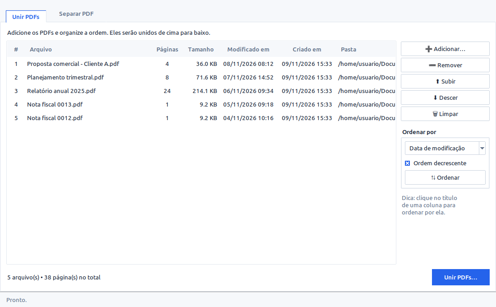
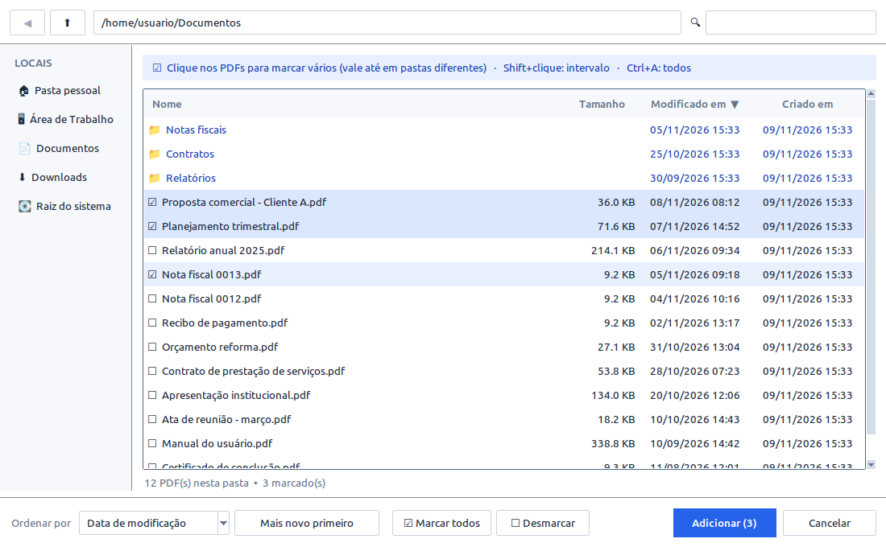
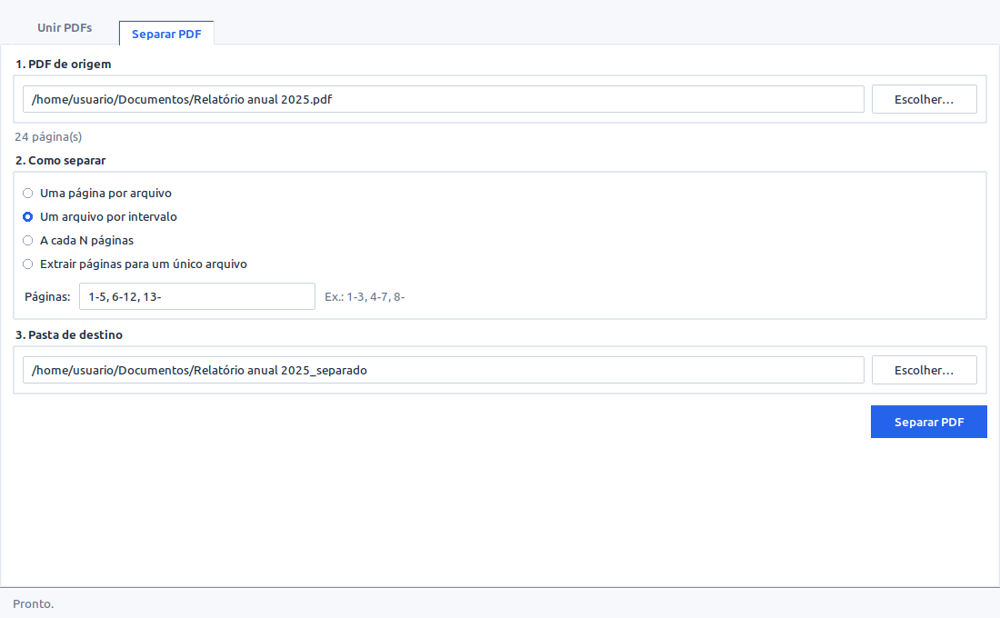
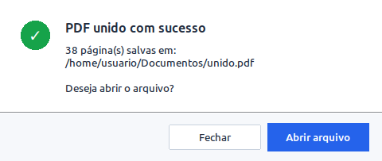

# Ferramentas PDF

Aplicativo com interface gráfica para **unir** e **separar** arquivos PDF.



## Funções
**Unir PDFs** – adicione vários arquivos, reorganize (subir/descer) ou ordene por nome,
data de modificação, data de criação, tamanho ou nº de páginas (crescente/decrescente;
também dá para clicar no título da coluna) e salve um único PDF.

**Seletor de arquivos** – clique nos PDFs para marcar vários de uma vez (☑), inclusive em
pastas diferentes; Shift+clique marca um intervalo e Ctrl+A marca todos.
Janela grande com locais rápidos (Pessoal, Downloads, Documentos…),
filtro por nome e colunas de tamanho, modificação e criação, ordenáveis com um clique.
A ordem escolhida e a última pasta ficam salvas.



**Padrão visual único** – todas as janelas grandes (principal, abrir PDFs, salvar como,
escolher pasta) têm o mesmo tamanho e abrem na mesma posição; o tamanho da janela
principal é lembrado. Avisos e perguntas usam o mesmo modelo de caixa de mensagem.

**Separar PDF** – quatro modos:
- Uma página por arquivo
- Um arquivo por intervalo (ex.: `1-3, 4-7, 8-`)
- A cada N páginas (ex.: `2`)
- Extrair páginas escolhidas para um único arquivo (ex.: `1, 3, 5-9`)



Ao terminar, o programa avisa onde os arquivos foram salvos e oferece abri-los:



## Instalar no Linux (Ubuntu/Debian/Fedora/Arch)
```bash
git clone https://github.com/dougllasdiniz91/ferramentas-pdf.git ~/ferramentas-pdf
cd ~/ferramentas-pdf
./instalar_linux.sh
```
Depois procure **Ferramentas PDF** no menu de aplicativos (ou rode `ferramentas-pdf`).
Também aparece em "Abrir com…" ao clicar com o botão direito em um PDF.

Desinstalar: `./desinstalar_linux.sh`

## Windows
Instale o Python em python.org (marque "Add Python to PATH"), copie esta pasta
para o Windows e dê dois cliques em `gerar_exe_windows.bat`.
O programa fica em `dist\FerramentasPDF.exe`.

## Rodar sem instalar
```bash
pip install pypdf
python3 ferramentas_pdf.py
```
